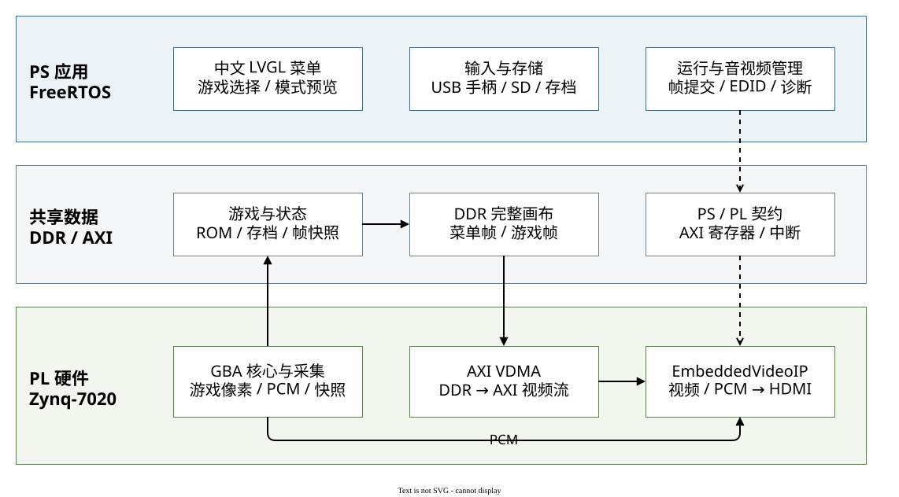

# GBA-Zynq7020

GBA-Zynq7020 是基于 Digilent Zybo Z7-20 的 FPGA 游戏机。PL 运行 GBA 核心和音视频接口，PS 运行 FreeRTOS 应用，提供中文 LVGL 菜单、USB 手柄、SD 卡 ROM 与存档管理。硬件使用 Vivado 2025.2.1，软件使用 Vitis 2025.2.1，自动化由 FPGAFlow 0.3.0 执行。

## 系统架构



图 1 PS 负责应用和资源管理，PL 负责 GBA 执行及音视频输出。DDR 保存应用画布，VDMA 将完整画面送入 EmbeddedVideoIP。数据流与菜单交接见[架构说明](docs/architecture.md)。

## 使用功能

- 中文 LVGL 游戏列表与详情，长路径水平滚动，按需平滑浏览。
- SD 卡 ROM 加载、存档和串口管理，USB 手柄操作及运行诊断。
- 480p60、720p60、1080p30 和 1080p60 输出，模式预览与确认倒计时。
- 切换失败恢复上次确认模式，恢复失败后尝试 480p60，DVI 兼容恢复保持至手动选择。
- HDMI 双声道 PCM 和 I²S 音频路由，菜单与游戏共享帧缓冲的首帧确认交接。

1080p60 在 XC7Z020-1 上使用超频串行化配置。最终实现 setup WNS 为 `+0.003 ns`，hold WHS 为 `+0.050 ns`，TNS/THS 为 0，实际 DRC Error 为 0。OSERDESE2 的 `−0.320 ns` pulse-width 单列于[验证记录](docs/validation-2026-11-24-delivery.md)。

## 开始构建

克隆本仓库，安装 [FPGAFlow](https://github.com/ArthurPan2026/FPGAFlow)，配置 Vivado/Vitis 路径与开发板连接后运行以下命令。

```sh
fpga-flow --project fpga-project.toml plan --target zybo_z7_20
fpga-flow --project fpga-project.toml build --stage boot --with-deps
fpga-flow --project fpga-project.toml deploy --target zybo_z7_20 --stage deploy_jtag --allow-destructive
```

仓库附带锁定版本的 EmbeddedVideoIP。更新 IP 时，在相邻目录克隆 canonical 仓库，由 workspace 完成验证、打包和导入。

```sh
fpga-flow --workspace fpga-workspace.toml plan --json
fpga-flow --workspace fpga-workspace.toml run --allow-side-effects --allow-destructive
```

GBA host/RTL 回归节点为可选项，使用 `--include-optional` 加入。逐步安装与 GUI 操作见[开始开发](docs/getting-started.md)，阶段、缓存和部署见[构建和部署](docs/build-and-test.md)。

## 工程与依赖

| 位置 | 内容 |
|---|---|
| `vivado/gba-zynq7020.xpr` | Vivado 工程入口与 BD 引用 |
| `src/rtl/` | GBA 核心、PS/PL 接口及项目 RTL |
| `src/ps/app/src/` | FreeRTOS 应用、LVGL、USB、存储和音视频管理 |
| `ip-repo/embedded-video-ip/` | 从 canonical release 导入的硬件 IP |
| `fpga-project.toml`、`fpga-workspace.toml` | 阶段、测试、依赖与跨项目工作流 |
| `build/fpga-flow/` | 本机运行档案、工具工作区和产物 |

EmbeddedVideoIP 使用 `0.3.0-dev.6 / coreRevision 7`。发布包与目录树哈希保存在 `ip-repo/embedded-video-ip-DEPENDENCY-LOCK.json`。字体生成方法与依赖流程见[维护说明](docs/fpga-flow-maintainer.md)。

## 验证与固化

480p60、720p60 和 1080p60 已完成板端状态与 C1-1 采集尺寸、帧率交叉核验。1080p60 采集记录包含 48 kHz 双声道音频。2026-11-24，用户确认菜单残影、首帧等待、游戏列表和路径滚动四项修复正常。

最新 `BOOT.BIN` 已写入 QSPI。普通 `deploy_qspi` 使用 `w25q128jv-qspi-x4-single`，offset 为 0，保留 blank-check，读回 Verify 默认关闭。完整参数与既有编程、读回记录见[交付验证记录](docs/validation-2026-11-24-delivery.md)。

## 文档与许可

[系统架构](docs/architecture.md) · [构建和部署](docs/build-and-test.md) · [验证矩阵](docs/verification.md) · [维护说明](docs/fpga-flow-maintainer.md)

自有 RTL 使用 CERN-OHL-W-2.0，自有 PS 应用使用 Apache-2.0，文档使用 CC-BY-4.0。GBA 核心、字体和其他组件的归属见[许可范围](LICENSES/README.md)。
