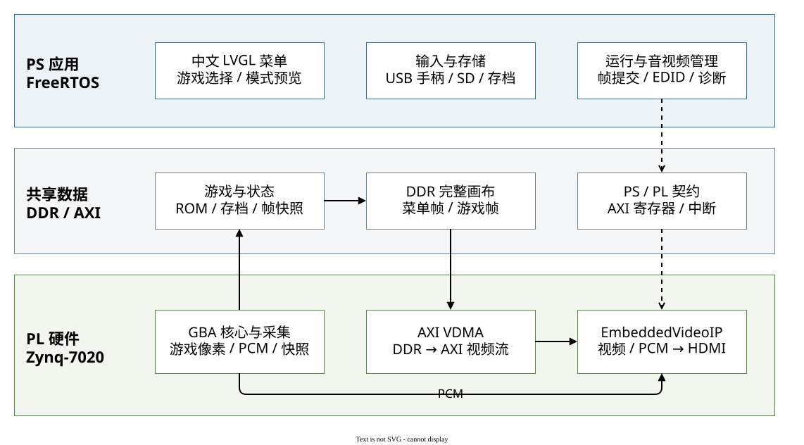
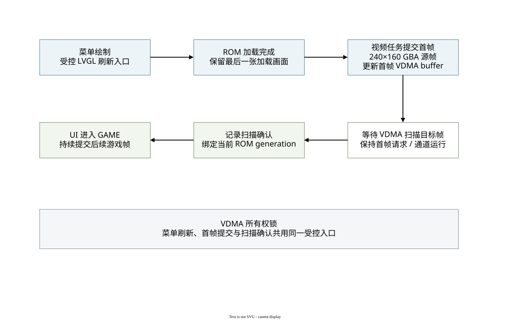

# 系统架构

## PS、PL 与存储

图 1　Zynq-7000 PS 运行 FreeRTOS 应用，PL 运行 GBA 核心、帧采集、PCM 和显示接口。DDR 连接 ROM、游戏画布、菜单画布与 VDMA。

PS 应用管理 SD 卡、ROM、存档、USB 手柄和中文 LVGL 界面。应用通过 AXI 寄存器配置 GBA 状态，通过帧快照取得已发布的游戏帧，将游戏画面写入完整输出画布。VDMA MM2S 将 DDR 画布送入 EmbeddedVideoIP。

PL 的 GBA 核心产生游戏像素与 PCM。音频封装将 16-bit PCM 放入 24-bit 槽位，低位补 8 个零，送入 HDMI 双声道 AXI 流。音频路由支持 HDMI 与 I²S。

PS/PL 契约由 `config/ps-pl-contract.json` 描述，生成 C 与 RTL 定义。视频模式统一列于 `video_modes.def`，供模式选择和构建配置使用。

## 帧缓冲交接

图 2　VDMA 所有权锁串行化菜单与游戏提交。首帧扫描确认按 ROM generation 保存，UI 据此进入 GAME。

菜单从受控入口调用 LVGL 绘制并提交画布。LVGL 刷新定时器保留对象、清除自动回调，使任务调度与手动绘制共用一个提交入口。

ROM 加载成功后，菜单保留最后一张完整加载画面。视频任务准备并清理目标画布，提交完整游戏帧，持续请求该帧直至 VDMA 当前扫描索引匹配且通道运行。确认后记录 generation 并继续游戏换帧，UI 读取确认状态更新模式。

## 模式与恢复

四模式为 480p60、720p60、1080p30 和 1080p60。预览切换保留确认倒计时，失败先恢复上次确认模式，再尝试 480p60。DVI 兼容恢复持续保持，手动选择模式后退出。切换过程按完整恢复组织，显示器可出现短暂黑屏。

EmbeddedVideoIP 使用 MMCM、BUFIO、BUFR 和 OSERDESE2 输出 TMDS。GBA 保留板级 BD、管脚与消费 Tcl，canonical IP 通过 workspace 发布包导入。

## 工程和产物

Vivado 入口为 `vivado/gba-zynq7020.xpr`。FPGAFlow 使用项目清单构建 hardware、platform、app 和 boot，输入未变时按哈希复用。IP 更新使用相邻 canonical 仓库和 `fpga-workspace.toml`。运行档案保存于 `build/fpga-flow/runs/`。

当前产物、时序、采集和人工验收见[交付验证记录](validation-2026-11-24-delivery.md)。
